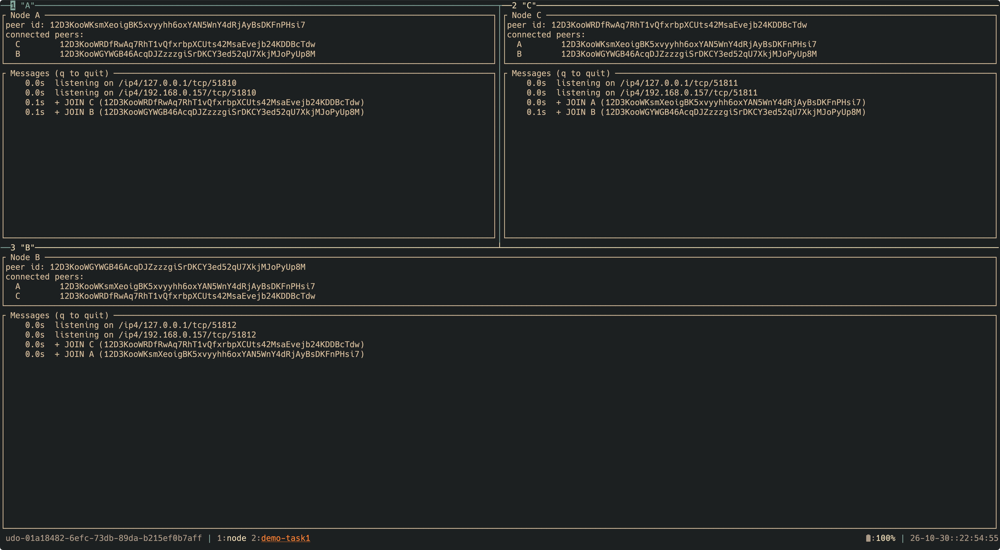
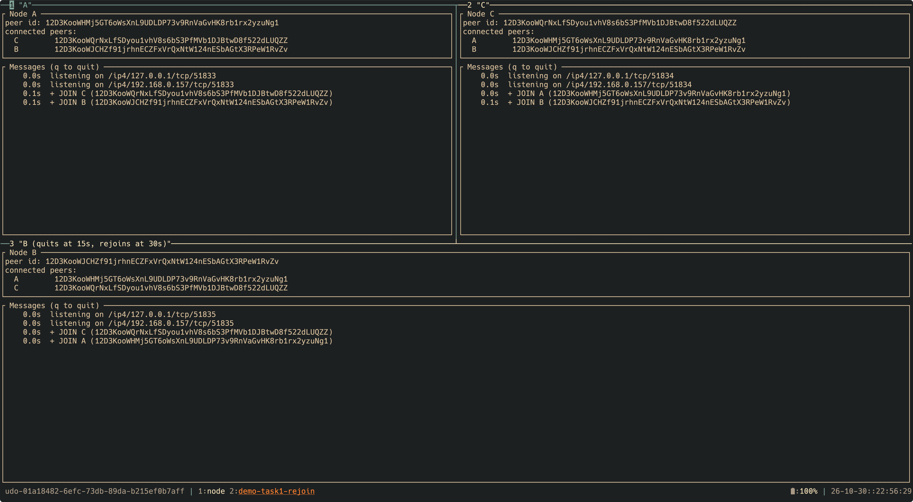
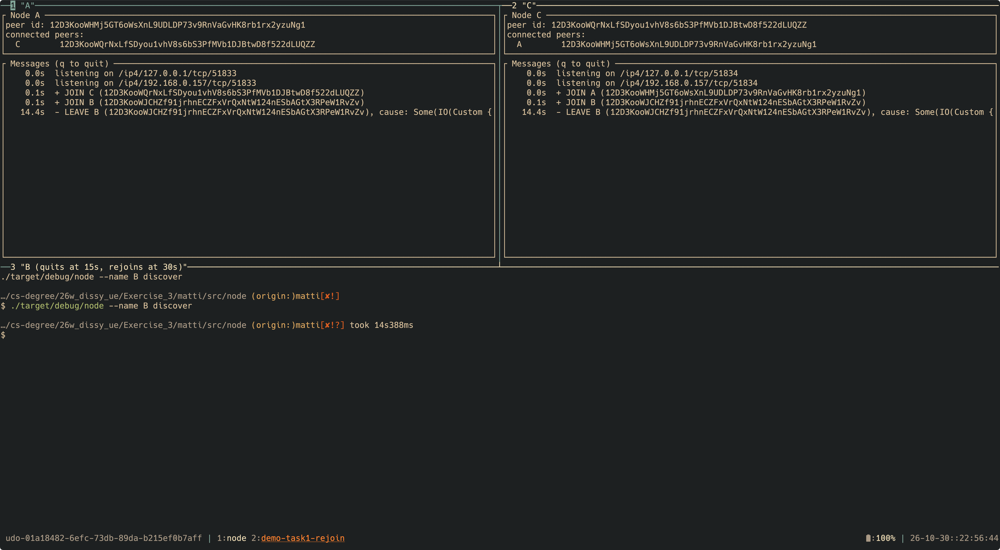
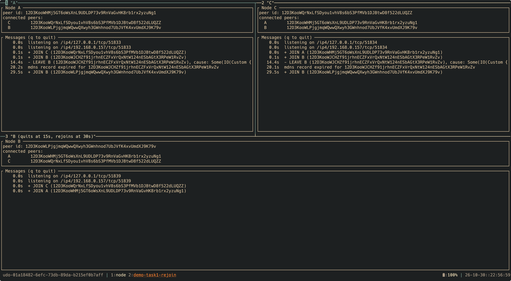
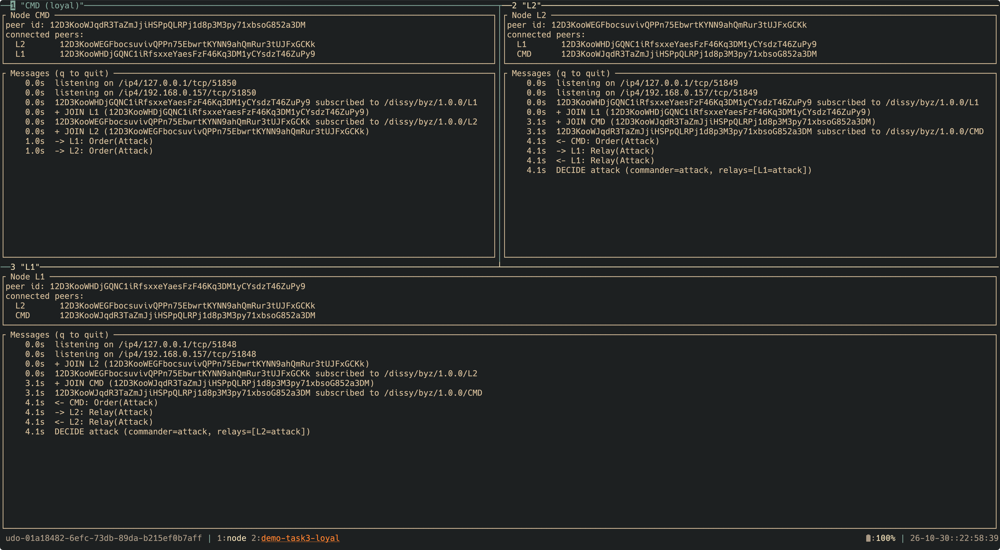
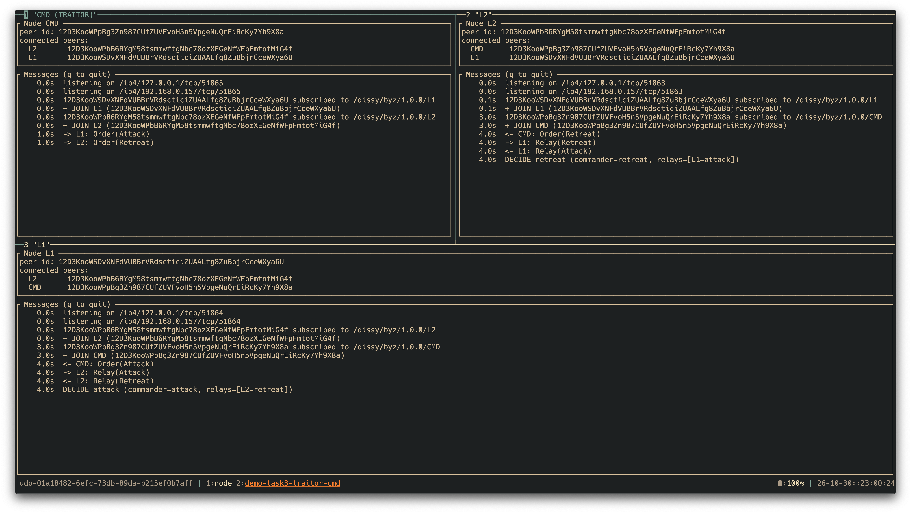
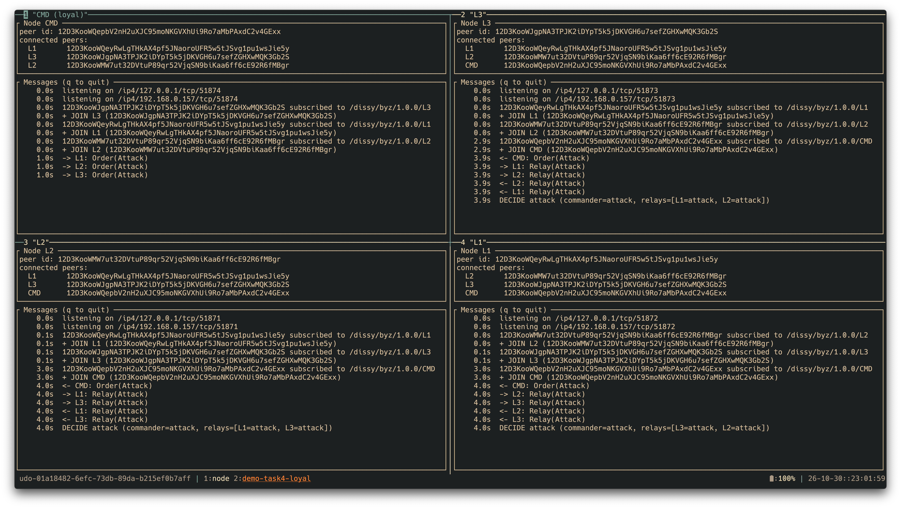
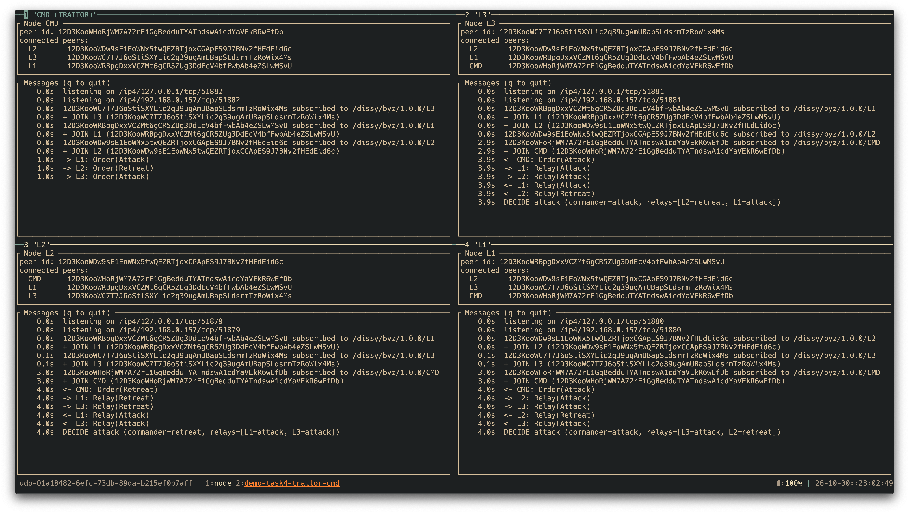
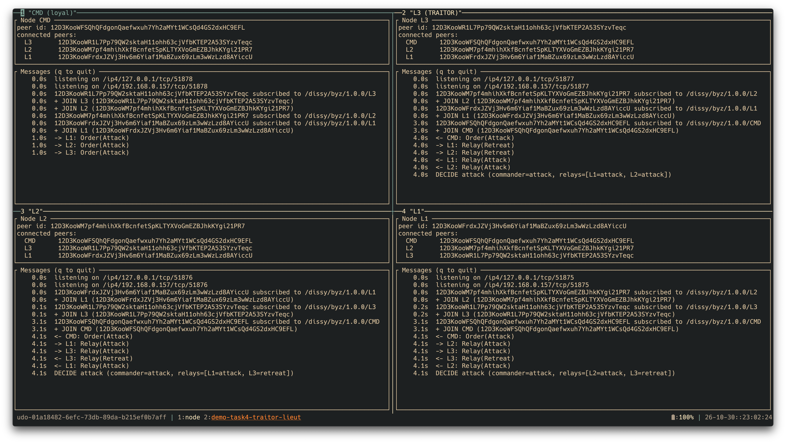

# EX0X Report: [Exercise Title]

**Student Name:** [leave this exactly like this]  
**Student ID:** `leave this exactly like this`  
**Group Name:** `MAP`

---

# Images


**Task 1**


**Task 1 - Rejoin Before Disconnect (Same as Crash)**


**Task 1 - Rejoin Before Startup (Same as Crash)**


**Task 1 - Rejoin After Reconnect (Same as Crash)**


**Task 2**


**Task 3 - Loyal**


**Task 3 - Commander Traitor**


**Task 3 - Lieutenant Traitor**


**Task 4 - Loyal**


**Task 4 - Commander Traitor**


**Task 4 - Lieutenant Traitor**

## Task 1 - [Title]

### Text & Sections
Add your explanations, notes, and answers to the task requirements here. 

### Table Sample
| Parameter | Value | Description |
| :--- | :--- | :--- |
| **Config A** | `100` | Sample setting |
| **Config B** | `200` | Sample setting |

---

## Task 2 - [Title]

### Code Sample
```python
# Insert your source code snippet here
def main():
    print("Distributed Systems Exercise")

if __name__ == "__main__":
    main()
```

### Figure Sample

Insert images or screenshots of your results, architectures, or execution outputs.

## Discussion Questions

>Question 1: What are your observations regarding...?

Your answer here...

>Question 2: Explain the trade-offs between...

Your answer here...

<!--
Delete this guide section before submitting — it must not appear in the report PDF.

How to generate the PDF (this repo):
- This is the template. Copy it to your folder as the report source:
    cp report.template.md Exercise_<N>/<you>/report.md
  then fill in the sections above.
- Build it with the Makefile (renders report.md -> dist/exc0N_report_<STUDENT_ID>.pdf):
    make submit EX=<N>
  (set your UIBK username once in .env; see the repo README "Setup"). Uses `npx md-to-pdf`.

Alternatives if you prefer:
- VS Code: install the "Markdown PDF" extension, right-click -> Markdown PDF: Export (pdf).
- Browser: open the Markdown preview, Cmd/Ctrl+P -> Save as PDF.
-->
