# EX03 Report: [Network Topologies, Peer Discovery & Byzantine Agreement]

**Student Name:** [leave this exactly like this]  
**Student ID:** `leave this exactly like this`  
**Group Name:** `MAP`

---

## Task 1 - [Discovering peers]

I decided to use `libp2p` as the peer-2-peer framework. As I am not familiar
with either Go, or WANTED to use JS and as the python version of `libp2p` is not
very mature yet, I decided to do this exercise in rust.

### Task 1.1

For the implementation I implemented a `Swarm` with custom `NetworkBehaviour`:

```rust
/// Send a request to get the name of another peer.
#[derive(Debug, Serialize, Deserialize)]
pub struct NameRequest;

/// Send a response to the `NameRequest` back to anothe peer.
#[derive(Debug, Serialize, Deserialize)]
pub struct NameRespone {
    /// Name of the node giving the response.
    pub name: String,
    // ...
}

/// Behaviour of the peer network, specifying builtin and custom protocols
/// 
/// The derive, derives the `Events` and further for each of the specified
/// protocols
#[derive(NetworkBehaviour)]
pub struct NetwBehaviour {
    /// mdns discovery protocol
    pub mdns: mdns::tokio::Behaviour,
    /// identify protocol
    pub identify: identify::Behaviour,
    /// ping protocol
    pub ping: ping::Behaviour,
    /// name exchange protocol: on the first connection to a peer we request its
    /// name; incoming requests are answered with our own name.
    pub name_exchange: request_response::json::Behaviour<NameRequest, NameRespone>,
    /// start time, log lines are stamped relative to it
    start: Instant,
    // ...
}

impl NetwBehaviour {
    /// create a new (default) NetwBehaviour for our custom peer network
    /// protocol
    pub fn new(
        key: &libp2p::identity::Keypair,
    ) -> Result<Self, Box<dyn std::error::Error + Send + Sync>> {
        let mdns_cfg = mdns::Config {
            // how long a discovered peer counts as valid without being heard
            // from again; afterwards mdns emits `Expired` (default: 6 min)
            ttl: Duration::from_secs(10),
            // how often we multicast "who is there?"; replies discover new
            // peers and refresh known ones. must be < ttl, otherwise known
            // peers expire between queries
            query_interval: Duration::from_secs(5),
            // no Ipv6 for our application
            enable_ipv6: false,
        };
        // identify config; announces our protocol family "/dissy/1.0.0" to peers
        let ident_cfg = identify::Config::new(PROTOCOL.into(), key.public());
        // ...
        Ok(Self {
            mdns: mdns::tokio::Behaviour::new(mdns_cfg, key.public().to_peer_id())?,
            identify: identify::Behaviour::new(ident_cfg),
            ping: ping::Behaviour::default(),
            name_exchange: request_response::json::Behaviour::new(
                [(NAME_PROTOCOL, ProtocolSupport::Full)],
                request_response::Config::default(),
            ),
            // ...
        })
    }
}
```

To actually build the `Swarm` we use the `SwarmBuilder` and build our `Swarm`
from the bottom up:

```rust
pub fn build_swarm_default()
-> Result<libp2p::swarm::Swarm<NetwBehaviour>, Box<dyn std::error::Error>> {
    // new swarm builder that will generate a swarm with new identity (public,
    // private key) pair
    let swarm_build_pipe = libp2p::SwarmBuilder::with_new_identity();

    // run the swarm on the tokio runtime (async sockets and timers)
    let swarm_build_pipe = swarm_build_pipe.with_tokio();

    // build a libp2p stack ontop of the tcp protocol
    //
    // TCP:   one byte pipe between two machines.
    // NOISE: runs handshake where both sides prove they hold the private key,
    //        associated with their peer_id. This makes the connection encrypted
    //        afterwards.
    // YAMUX: split the single connection, into many lightweight streams. In our
    //        case each of, identify, ping, and name exchange get their own stream.
    //        (This is basically a connection multiplexing addition.)
    let swarm_build_pipe = swarm_build_pipe.with_tcp(
        tcp::Config::default(), // default libp2p tcp config
        noise::Config::new,     // default libp2p noise handshake config
        yamux::Config::default, // default libp2p yamux config
    )?;

    // configure the peer network behaviour, with our custom behaviour.
    let swarm_build_pipe = swarm_build_pipe.with_behaviour(NetwBehaviour::new)?;

    // keep connections open even when no protocol stream is active; otherwise
    // the swarm closes idle connections and peers would appear to leave
    let swarm_build_pipe = swarm_build_pipe
        .with_swarm_config(|c| c.with_idle_connection_timeout(Duration::from_secs(u64::MAX)));

    // build the swarm from the builder
    Ok(swarm_build_pipe.build())
}
```

And the `Swarm` gets build directly `Node::new()`. Here I also added a `Node::listen()` method and multiple handlers for our `NetwBehaviour`:

```rust
/// a running peer: the libp2p swarm plus our application state
pub struct Node {
    /// which kind of the app is run (simple `Discover`, `Hello` or `Byzantine`)
    pub(crate) app: App,
    /// event log shown in the messages pane (or printed in plain mode)
    pub(crate) log: Vec<String>,
    /// print to stdout instead of drawing the tui (e.g. scripts)
    pub(crate) plain: bool,
    /// our own name, given on the command line
    pub(crate) name: String,
    /// the libp2p swarm driving all connections and protocols
    pub(crate) swarm: Swarm<NetwBehaviour>,
    /// names of connected peers, learned through the name exchange protocol
    pub(crate) names: HashMap<PeerId, String>,
    // ...
}

impl Node {
    /// create a new node with a fresh identity; does not listen yet
    pub fn new(app: App, plain: bool, name: String) -> Result<Self, Box<dyn std::error::Error>> {
        let swarm = build_swarm_default()?;
        let mut node = Self {
            app,
            log: Vec::new(),
            plain,
            name,
            swarm,
            names: HashMap::new(),
            roles: HashMap::new(),
            start: Instant::now(),
        };
        match node.app {
            App::Discover => {}
            App::Hello => node.hello_init()?,
            App::Byzantine(_) => node.byz_init()?,
        }
        Ok(node)
    }

    /// listen on all local interfaces, the OS picks a free tcp port. mdns
    /// announces these listen addresses, so without listening we cannot be
    /// discovered.
    pub fn listen(&mut self) -> Result<(), Box<dyn std::error::Error>> {
        self.swarm.listen_on("/ip4/0.0.0.0/tcp/0".parse()?)?;
        Ok(())
    }

    /// event loop: the swarm only makes progress while it is polled here
    pub async fn run(&mut self) {
        if self.plain {
            self.run_plain().await;
        } else {
            self.run_tui().await;
        }
    }

    /// run the peer log on std stdout
    async fn run_plain(&mut self) {
        let mut tick = tokio::time::interval(Duration::from_secs(1));
        loop {
            // whichever is ready first: periodic status output or the next
            // swarm event
            tokio::select! {
                _ = tick.tick() => {
                    self.print_status();
                    self.on_tick();
                },
                ev = self.swarm.select_next_some() => self.handle_event(ev),
            }
        }
    }

    /// run the peer log in TUI
    async fn run_tui(&mut self) {
        let mut terminal = ratatui::init();
        let mut keys = EventStream::new();
        let mut tick = tokio::time::interval(Duration::from_secs(1));
        let mut redraw = tokio::time::interval(Duration::from_millis(100));
        loop {
            tokio::select! {
                _ = tick.tick() => self.on_tick(),
                ev = self.swarm.select_next_some() => self.handle_event(ev),
                Some(Ok(key)) = keys.next() => {
                    if is_quit(&key) {
                        break;
                    }
                }
                _ = redraw.tick() => {
                    if terminal.draw(|frame| crate::ui::draw(frame, self)).is_err() {
                        break;
                    }
                }
            }
        }
        ratatui::restore();
    }
    
    /// what to do on tick
    fn on_tick(&mut self) {
        // reconnect: mdns only emits `Discovered` for new (peer, addr) pairs, so a
        // dropped connection to a peer whose record is still valid would never be
        // redialed. dial every discovered but unconnected peer; addresses come from
        // mdns. a failed dial is silent, the peer is retried each tick until its mdns
        // record expires (ttl, 10s without a reply).
        let lost: Vec<PeerId> = self
            .swarm
            .behaviour()
            .mdns
            .discovered_nodes()
            .filter(|p| !self.swarm.is_connected(p))
            .copied()
            .collect();
        for p in lost {
            let _ = self.swarm.dial(p);
        }

        match self.app {
            App::Discover => {}
            App::Hello => self.hello_tick(),
            // ...
        }
    }

    // ...

    /// dispatch swarm events: behaviour events go to their protocol handler,
    /// connection events are handled here
    fn handle_event(&mut self, event: SwarmEvent<NetwBehaviourEvent>) {
        match event {
            SwarmEvent::Behaviour(NetwBehaviourEvent::Mdns(ev)) => self.on_mdns(ev),
            SwarmEvent::Behaviour(NetwBehaviourEvent::NameExchange(ev)) => {
                self.on_name_exchange(ev)
            }
            SwarmEvent::Behaviour(NetwBehaviourEvent::Ping(ev)) => self.on_ping(ev),
            SwarmEvent::Behaviour(NetwBehaviourEvent::Gossipsub(ev)) => self.on_gossipsub(ev),
            SwarmEvent::Behaviour(NetwBehaviourEvent::Identify(ev)) => self.on_identify(ev),
            SwarmEvent::NewListenAddr { address, .. } => {
                self.log(format!("listening on {address}"));
            }
            SwarmEvent::ConnectionEstablished {
                peer_id,
                num_established,
                ..
            } => {
                // only on the first connection; both sides may dial each other
                // at once
                if num_established.get() == 1 {
                    self.swarm
                        .behaviour_mut()
                        .name_exchange
                        .send_request(&peer_id, NameRequest);
                }
            }
            // num_established == 0: the last connection to this peer is gone.
            // cause is None for a clean close, Some(error) e.g. on a crash
            SwarmEvent::ConnectionClosed {
                peer_id,
                num_established: 0,
                cause,
                ..
            } => {
                let who = self.names.remove(&peer_id).unwrap_or_else(|| "?".into());
                self.roles.remove(&peer_id);
                self.log(format!("- LEAVE {who} ({peer_id}), cause: {cause:?}"));
            }
            _ => {}
        }
    }

    /// mdns only reports peers, it does not connect to them; we dial ourselves
    fn on_mdns(&mut self, ev: mdns::Event) {
        match ev {
            mdns::Event::Discovered(list) => {
                // one entry per (peer, address); a peer may show up with
                // several addresses
                for (peer, addr) in list {
                    if !self.swarm.is_connected(&peer)
                        && let Err(e) = self.swarm.dial(addr)
                    {
                        self.log(format!("dial {peer} failed: {e}"));
                    }
                }
            }
            // only logged: discovery and connections are separate layers, a
            // peer may still be connected after its mdns record expired
            mdns::Event::Expired(list) => {
                for (peer, _) in list {
                    self.log(format!("mdns record expired for {peer}"));
                }
            }
        }
    }

    // ...
        
    /// answer name requests with our own name, store names from responses
    fn on_name_exchange(&mut self, ev: request_response::Event<NameRequest, NameRespone>) {
        match ev {
            // `peer` is the noise-verified peer id of the connection, while
            // the name in a response is only claimed by that peer
            request_response::Event::Message { peer, message, .. } => match message {
                // `channel` is a one-time handle to answer this request
                request_response::Message::Request { channel, .. } => {
                    // ...
                    let resp = NameRespone {
                        name: self.name.clone(),
                        // ...
                    };
                    // Err only if the connection already closed; nothing to
                    // do then
                    let _ = self
                        .swarm
                        .behaviour_mut()
                        .name_exchange
                        .send_response(channel, resp);
                }
                request_response::Message::Response { response, .. } => {
                    if self
                        .names
                        .iter()
                        .any(|(p, n)| *p != peer && *n == response.name)
                    {
                        self.log(format!("WARNING duplicate name {} ({peer})", response.name));
                    }
                    // insert returns None for a new peer, so JOIN prints once
                    if self.names.insert(peer, response.name.clone()).is_none() {
                        self.log(format!("+ JOIN {} ({peer})", response.name));
                    }
                    // ...
                }
            },
            // ...
        }
    }

    // ...
}
```

Additionally I added a Argument Parser, to be able to use the Program for all of
the following Tasks and switch between the `Node::app` (e.g. `App::Hello`(Task
2) or `App::Byzantine`(Task 3)). To not spam peer messages I added a very small
TUI, that shows the connected peers in the top pane, and the log of what is happening
in the bottom pane.

```rust
/// two panes: status (own id + connected peers) on top, event log below
pub fn draw(frame: &mut Frame, node: &Node) {
    let status = status_lines(node);
    // ...

    // render the status pane
    frame.render_widget(
        Paragraph::new(status).block(Block::bordered().title(format!(" Node {} ", node.name))),
        status_area,
    );

    // only the newest lines that fit, so the log scrolls with new messages
    // ...
    let items = node.log.iter().skip(skip).map(String::as_str);
    
    // render the log pane
    frame.render_widget(
        List::new(items).block(Block::bordered().title(" Messages (q to quit) ")),
        log_area,
    );
}

// compile the status lines for the tui
fn status_lines(node: &Node) -> Vec<Line<'_>> {
    // ...
    lines
}
```

To run the program use and the help flag `--help`
```bash
cargo run -- --help
```

**Output**
```
Program Arguments

Usage: node [OPTIONS] --name <NAME> [COMMAND]

Commands:
  discover   TASK 1: discover peers and print them (default)
  hello      TASK 2: periodically publish a hello message
  byzantine  TASK 3: byzantine generals, oral messages OM(1)
  help       Print this message or the help of the given subcommand(s)

Options:
      --name <NAME>  unique name of this node, sent to peers via the name exchange protocol
      --plain
  -h, --help         Print help
```

As you can see there is 3 subcommands for each Task {1,2,3}. The Discover
application is the default application to run. The `--plain` flag lets you run
the program with stdout output, so no TUI.

To efficiently run the program in multiple terminal (pane's) respectively, I
added a small script, namely `demo.sh`. This program uses `tmux`, so if you use
this, make sure you run it inside of a `tmux` session.

> IMPORTANT: The script was fully created by Claude Opus 5.5, as I did not see
  the point in writing (and debugging this myself). Prompt: "is it possible to
  create a bash script that creats 3 (or 4) panes in tmux and then runs the
  commands for each of the exercises (nodes named A through D): 1.1 3
  discovering peers, 1.2 3 discovering peers, node B rejoining, 2.2 3 peers
  exchanging messages (hello subcommand), 3.2 3 nodes byzantine (1 cmd, 2
  lieut), first all loyal, then commander traitor, then lieut traitor, 3.3 same
  as 3.2 but with 4 nodes."

Now we can finally have a look at the first exercise: 3 (or more) nodes
discovering each other:

**Task 1**
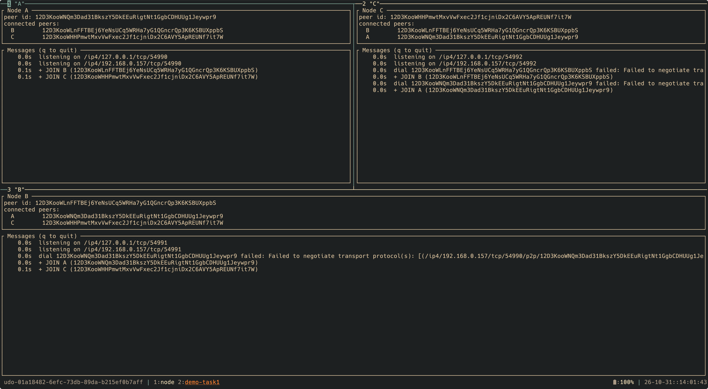

As we can clearly see, every node (A through C) discovers its peers (visible in
the top pane respectively.) Also the JOIN messages are printed in each log
respectively further making visible each node got discovered

> Note: The errors you can see here are intended, and can be ignored from now
  on. These come from checking on each tick, if the node is still reachable.
  When the `dial()`'s happen simultaneous this throws an error tho.

### Task 1.2

For this exercise we need to show that node B disconnects and rejoins the
network. The following 3 pictures should make this clear.

**Task 1 - Rejoin Before Disconnect (Same as Crash)**
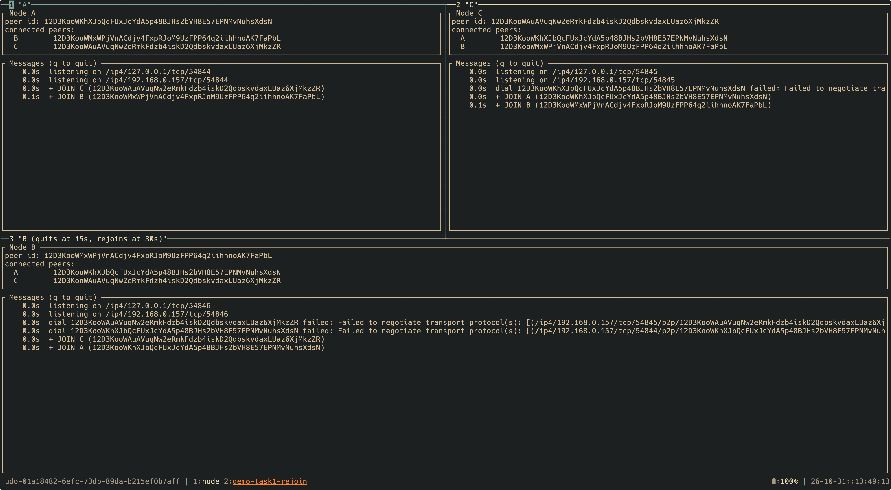

**Task 1 - Rejoin Before Reconnect (Same as Crash)**
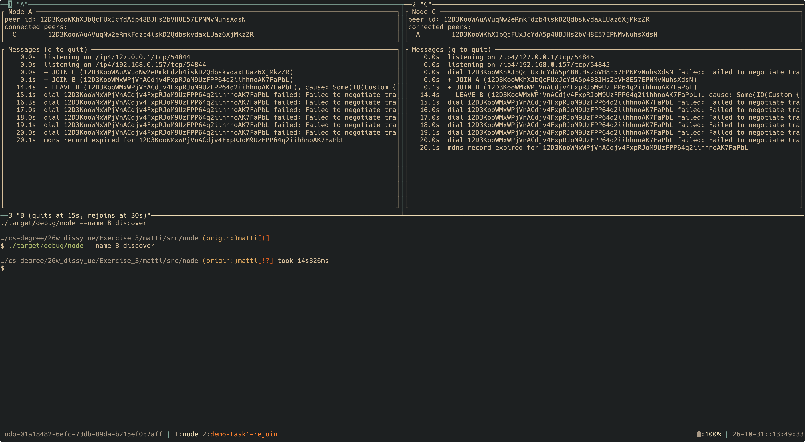

**Task 1 - Rejoin After Reconnect (Same as Crash)**
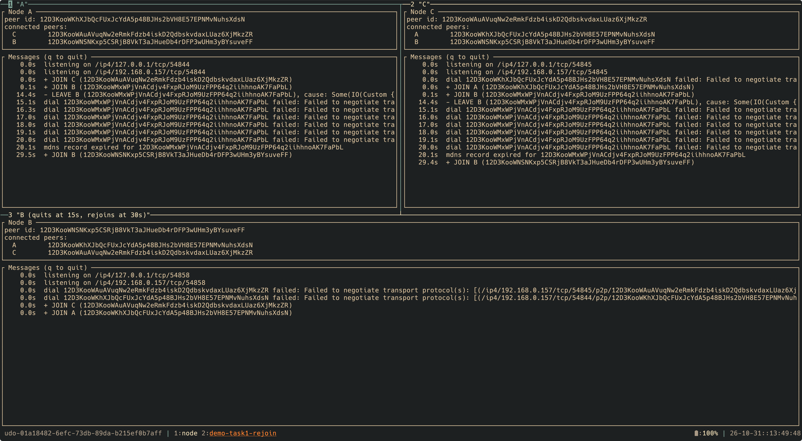

In the last log we can see, that both nodes A and C recognized that node B
disconnected and a few seconds later reconnected/connected again. This behaviour
is handled in `Node::handle_event` in the `match` for `ConnectionEstablished`
and `ConnectionClosed`. Additionally it is good to know here that the actual `+
JOIN` is only printed, when the name of the connecting node is exchanged
respectively. This is a custom protocol I designed to make sure to have a better
way to distinguish the nodes from other nodes.

Now onto the questions:
- How does a node learn that another node is available?

  A node learns that another node is available through `libp2p`'s `mDNS`. In
  `NetwBehaviour::new` we configured mdns to have a `ttl: Duration::from_secs(10)`, 
  so each `mDNS` record is valid for 10 seconds. This intern does not mean that
  the connection is closed afterwards. The underlying `tcp` connection can be
  connected well into the future of this. The `query_interval: Duration::from_secs(5)`
  tells our protocol how often to query for available nodes. 

  How does `mDNS` work? `libp2p`'s mDNS does not resolve hostnames. Every 5
  seconds (`query_interval`) each node multicasts a DNS query for the service
  `_p2p._udp.local` to `224.0.0.251:5353`. Every libp2p node on the LAN answers
  with TXT records that already contain its address and identity, e.g.
  `dnsaddr=/ip4/192.168.0.157/tcp/54541/p2p/<PeerId>`, valid for `ttl` = 10s. A
  new (PeerId, address) pair triggers `Discovered` and we dial it, a record not
  refreshed within the ttl triggers `Expired`. The PeerId is only a claim: it is
  proven by the noise handshake when dialing.


- What happens when Node B leaves, and what happens when it joins again?

  When node B leaves cleanly, its TCP connections are closed and A and C
  receive `ConnectionClosed` immediately (on a crash or network loss, the ping
  protocol detects it after its timeout). They remove B from `names` and log
  `LEAVE`. Until B's mDNS record expires (at most 10s), A and C keep redialing B
  every tick, which shows up as failed dials in the log. This is intended:
  discovery and connections are separate layers. When B joins again, it starts
  with a new keypair and therefore a new PeerId. For A and C this is a new
  (PeerId, address) pair, so mDNS reports `Discovered`, they dial it, exchange
  names and log `JOIN b` with the new PeerId.

- Your discovery mechanism tells you a node is reachable. Can you trust that a
  discovered node is who it claims to be, or that its messages are truthful?

  Only partially. Each node generates a keypair at startup and its PeerId is
  derived from the public key. The `Noise` handshake proves that the remote
  holds the private key for that PeerId, so the PeerId of a connection is
  verified. The name it announces through our name exchange however is only a
  claim. Gossipsub signs every message (`ValidationMode::Strict`), so we know
  who sent it, but not whether the content is true: a byzantine node signs its
  lies with its own valid key. This is exactly the problem of Task 3.

---

## Task 2 - [Exchange messages between peers]

In this exercise we are tasked to create a message exchange between the peers.
This is done through the `gossipsub` extension in `libp2p` (a
publisher/subscriber implemenation).

### Task 2.1

We extend our `NetworkBehaviour` with the `gossipsub` protocol:

```rust
#[derive(NetworkBehaviour)]
pub struct NetwBehaviour {
    ...
    /// gossipsub for Task 2 and 3. Publisher/Subscriber implementation for p2p.
    pub gossipsub: gossipsub::Behaviour,
    ...
}


impl NetwBehaviour {
    pub fn new(
        key: &libp2p::identity::Keypair,
    ) -> Result<Self, Box<dyn std::error::Error + Send + Sync>> {
        ...
        // strictly check messages to be signed
        let gossipsub_cfg = gossipsub::ConfigBuilder::default()
            .validation_mode(ValidationMode::Strict)
            .build()?;
        Ok(Self {
            ...
            gossipsub: gossipsub::Behaviour::new(
                gossipsub::MessageAuthenticity::Signed(key.clone()), // sign messages with the senders key
                gossipsub_cfg,
            )?,
        })
    }
```

And subscribe to a `hello` from nodes topic:

```rust
impl Node {
    /// subscribe to the topic in gossipsip
    pub(crate) fn hello_init(&mut self) -> Result<(), Box<dyn std::error::Error>> {
        self.swarm.behaviour_mut().gossipsub.subscribe(&topic())?;
        Ok(())
    }

    /// tick/publish a new message
    pub(crate) fn hello_tick(&mut self) {
        let msg = format!("Hello from Node {}", self.name);
        if let Err(e) = self.swarm.behaviour_mut().gossipsub.publish(topic(), msg) {
            self.log(format!("publish failed: {e}"));
        }
    }

    /// receive a published message on the topic you subscribed to
    pub(crate) fn hello_receive(&mut self, message: gossipsub::Message) {
        // sender = signed source PeerId, mapped to the name from name exchange
        let from = message
            .source
            .and_then(|p| self.names.get(&p).cloned())
            .unwrap_or_else(|| "?".into());
        self.log(format!(
            "<- {from}: {}",
            String::from_utf8_lossy(&message.data)
        ));
    }
}
```

Our topic is specified here:

```rust
/// topic/protocol name
fn topic() -> IdentTopic {
    IdentTopic::new(format!("/dissy/hello/{VERSION}"))
}
```

We handle the gossipsub events in `node.rs`. The 2 events we handle are
`Subscribed` when a node subscribes to a specific topic, and `Message` when an
incoming message needs to be handled:

```rust
impl Node {
    //...
    
    /// handle the gossipsub publisher/subscriber protocol.
    fn on_gossipsub(&mut self, ev: gossipsub::Event) {
        match ev {
            gossipsub::Event::Message { message, .. } => match self.app {
                App::Discover => {}
                App::Hello => self.hello_receive(message),
                // ...
            },
            gossipsub::Event::Subscribed { peer_id, topic } => {
                // ...
            }
            _ => {}
        }
    }
    
    //...
}
```

In all of our application there is no ip's hardcoded (except the multicast ip
for incoming traffic) and all of the discovery and now publish subscribing is
happening through a self-established peer-2-peer network.

We can see that our message passing is working in this picture:

**Task 2**
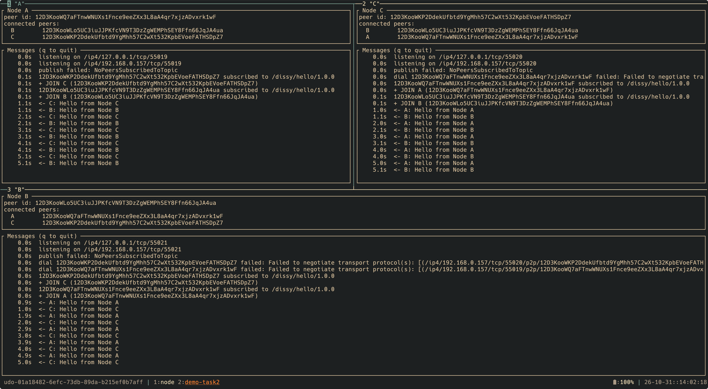

### Task 2.2


- What is the main difference between static configuration and dynamic
  discovery?

  With static configuration, the addresses of all peers are known in advance,
  e.g. written into a config file. This is simple and predictable, but every
  change (a new node, a changed IP, a restart on another port) requires editing
  the configuration. With dynamic discovery, nodes find each other at runtime;
  in our case through `mDNS`. Nodes can join, leave and change their address
  without any configuration, which is also why we can let the OS pick a random
  port (`/ip4/0.0.0.0/tcp/0`). The downside is that `mDNS` only works inside the
  local network (multicast), and we have to trust whoever answers.

- Why is the publish/subscribe pattern useful for communication between
  distributed processes?

  Publishers send messages to a topic without knowing who receives them, and
  subscribers receive messages from a topic without knowing who sent them. This
  decouples the processes: nodes can join or leave without the other nodes
  having to change anything. Gossipsub additionally forwards messages through
  its mesh, so a node does not need a direct connection to every other node. We
  use this in Task 2 to broadcast the hello message, and in Task 3 every general
  has its own topic (`/dissy/byz/1.0.0/<name>`) that acts as its inbox.

- Is peer discovery sufficient to make an application fault-tolerant? Explain
  briefly.

  No. Discovery only tells us which nodes are reachable right now; it does not
  keep the application working correctly when nodes fail. Fault tolerance needs
  additional mechanisms: detecting failures (in our case the ping protocol),
  reconnecting (our redial on every tick), handling messages that are lost while
  a node is away (gossipsub does not store them), timeouts so a node does not
  wait forever (`DECIDE_TIMEOUT` in Task 3), and handling nodes that lie (Task
  3). Discovery is therefore a building block, not a solution on its own.

---

## Task 3 - [The Byzantine Generals Problem]

For this exercise we have to implement the Byzantine Generals problem. First we
extend our custom `NameExchange` protocol to now also send the role of the
connected node (either `Roler::Commander` or `Role::Lieutenant`) in the response.

### Task 3.1

```rust
#[derive(Debug, Serialize, Deserialize)]
pub struct NameRespone {
    // ...
    /// role in the byzantine run, None for discover/hello
    pub role: Option<Role>,
}
```

We insert this role into a new map in `Node::roles: HashMap<_, _>`. We also
handle the tick for byzantine and dispatch byz_receive

```rust
/// a running peer: the libp2p swarm plus our application state
pub struct Node {
    // ...
    pub(crate) roles: HashMap<PeerId, Role>,
}

impl Node {
    fn on_tick(&mut self) {
        // ...
        match self.app {
            // ...
            App::Byzantine(_) => self.byz_tick(),
        }
    }
    
    fn on_name_exchange(&mut self, ev: request_response::Event<NameRequest, NameRespone>) {
        match ev {
            
                // ...
            
                request_response::Message::Response { response, .. } => {
                    // ...
                    if let Some(role) = response.role {
                        self.roles.insert(peer, role);
                    }
                }
            }
        }
    }
    
    fn on_gossipsub(&mut self, ev: gossipsub::Event) {
        match ev {
            gossipsub::Event::Message { message, .. } => match self.app {
                // ...
                App::Byzantine(_) => self.byz_receive(message),
            },
            // ...
        }
    }
}
```

For the Byzantine logic in `byzantine.rs` we add the `Role` and `Order`. As for
this problem we have 2 rounds of communication We also added an dispatch enum
`ByzMsg` that makes clear where a message comes from:

```rust
const DECIDE_TIMEOUT: Duration = Duration::from_secs(10);

/// role of the node
#[derive(Debug, Clone, Copy, PartialEq, Eq, Serialize, Deserialize, ValueEnum)]
pub enum Role {
    Commander,
    Lieutenant,
}

/// order from the commander, or a "fake" order
#[derive(Debug, Clone, Copy, PartialEq, Eq, Serialize, Deserialize, ValueEnum)]
pub enum Order {
    Attack,
    Retreat,
}

/// no sender field: the sender is the signed gossipsub source
#[derive(Debug, Serialize, Deserialize)]
pub enum ByzMsg {
    /// Round 1: commander -> Lieutenant
    Order(Order),
    /// Round 2: "the commander told me"
    Relay(Order),
}

impl Order {
    /// what a traitor sends
    pub fn flip(self) -> Self {
        match self {
            Order::Attack => Order::Retreat,
            Order::Retreat => Order::Attack,
        }
    }
}
```

The state (machine) of our problem is defined and intialized as follows:

```rust
/// state of one general
pub struct Byzantine {
    pub role: Role,
    pub traitor: bool,
    /// number of lieutenants in the run (2 or 3)
    pub lieutenants: usize,
    /// order a commander gives (ignored for lieutenants)
    pub order: Order,
    /// commander: orders have been sent
    sent: bool,
    /// lieutenant: order received directly from the commander
    pub from_commander: Option<Order>,
    /// lieutenant: own relay has been sent
    relayed: bool,
    /// lieutenant: values relayed by the other lieutenants
    pub relays: HashMap<PeerId, Order>,
    /// messages from peers whose role we do not know yet
    pending: Vec<(PeerId, ByzMsg)>,
    /// lieutenant: decide at the latest at this point
    deadline: Option<Instant>,
    pub decision: Option<Order>,
}

impl Byzantine {
    pub fn new(role: Role, traitor: bool, lieutenants: usize, order: Order) -> Self {
        Self {
            role,
            traitor,
            lieutenants,
            order,
            sent: false,
            from_commander: None,
            relayed: false,
            relays: HashMap::new(),
            pending: Vec::new(),
            deadline: None,
            decision: None,
        }
    }
}
```

```rust
impl Node {
    /// init the byzantine publish/subscribe protocol. this is basically
    /// subscribing to the protocol.
    pub(crate) fn byz_init(&mut self) -> Result<(), Box<dyn std::error::Error>> {
        self.swarm
            .behaviour_mut()
            .gossipsub
            .subscribe(&inbox(&self.name))?;
        Ok(())
    }

    /// get the `Byzantine` state (machine)
    fn byz(&self) -> &Byzantine {
        // ...
    }

    /// get the `Byzantine` state (machine) as mutable
    fn byz_mut(&mut self) -> &mut Byzantine {
        // ...
    }

    /// run the tick for `App::Byzantine`.
    pub(crate) fn byz_tick(&mut self) {
        self.byz_retry_pending();
        match self.byz().role {
            Role::Commander => self.commander_try_send(),
            Role::Lieutenant => {
                self.lieutenant_try_relay();
                self.lieutenant_try_decide();
            }
        }
    }

    /// get a list of all the names of the already ready/subscribed to the topic
    /// lieutenants.
    fn ready_lieutenants(&self) -> Vec<String> {
        // ...
    }

    /// send a message to a node
    fn byz_send(&mut self, to: &str, msg: ByzMsg) {
        let data = serde_json::to_vec(&msg).expect("ByzMsg always serializes");
        match self
            .swarm
            .behaviour_mut()
            .gossipsub
            .publish(inbox(to), data)
        {
            Ok(_) => self.log(format!("-> {to}: {msg:?}")),
            Err(e) => self.log(format!("send to {to} failed: {e}")),
        }
    }

    /// round 1: once all lieutenants are ready, send each one an order. A
    /// traitor sends the opposite order to every second lieutenant.
    fn commander_try_send(&mut self) {
        // ...

        // only send command out from the commander when all needed
        // lieutenants are connected
        let (n, order, traitor) = (b.lieutenants, b.order, b.traitor);
        let targets = self.ready_lieutenants();
        if targets.len() < n {
            return;
        }

        // send to the lieutenants while flipping every second order when a traitor
        for (i, name) in targets.iter().enumerate() {
            let value = if traitor && i % 2 == 1 {
                order.flip()
            } else {
                order
            };
            self.byz_send(name, ByzMsg::Order(value));
        }
        self.byz_mut().sent = true;
    }

    /// round 2: forward the commander's order to all other lieutenants, as
    /// our own claim. A traitor forwards the opposite.
    fn lieutenant_try_relay(&mut self) {
        // ...

        let (n, traitor) = (b.lieutenants, b.traitor);
        let targets = self.ready_lieutenants();
        // check if all lieutenants are connected (specified as arg)
        if targets.len() < n - 1 {
            return;
        }

        // flip the order if a traitor
        let value = if traitor { received.flip() } else { received };
        // round 2 only sends to lieutenants, so only send to them
        for name in &targets {
            self.byz_send(name, ByzMsg::Relay(value));
        }
        self.byz_mut().relayed = true;
    }

    /// decide once all values are there, or when the deadline has passed
    fn lieutenant_try_decide(&mut self) {
        // ...

        // decide if to `Attack` or `Retreat`
        let relays: Vec<Order> = b.relays.values().copied().collect();
        let decision = decide(b.from_commander, &relays);
        let relay_list: Vec<String> = b
            .relays
            .iter()
            .map(|(p, o)| {
                let name = self.names.get(p).map(String::as_str).unwrap_or("?");
                format!("{name}={o}")
            })
            .collect();
        
        let line = format!(
            "DECIDE {decision} (commander={}, relays=[{}]{})",
            b.from_commander.map_or("none".into(), |o| o.to_string()),
            relay_list.join(", "),
            if timed_out && !complete {
                ", timeout"
            } else {
                ""
            },
        );
        self.byz_mut().decision = Some(decision);
        self.log(line);
    }

    /// a byzantine message arrived on our inbox
    pub(crate) fn byz_receive(&mut self, message: gossipsub::Message) {
        // ...
        
        // handle the message
        self.byz_handle(source, msg);
        // if lieutenant then try relay and decide
        if self.byz().role == Role::Lieutenant {
            self.lieutenant_try_relay();
            self.lieutenant_try_decide();
        }
    }

    /// accept a message only if it fits the sender's role: orders only from
    /// the commander, relays only from lieutenants
    fn byz_handle(&mut self, source: PeerId, msg: ByzMsg) {
        let Some(role) = self.roles.get(&source).copied() else {
            // name exchange with this peer not finished yet, retry on tick
            self.byz_mut().pending.push((source, msg));
            return;
        };
        
        // the name of the node of the incoming msg
        let from = self
            .names
            .get(&source)
            .cloned()
            .unwrap_or_else(|| "?".into());
        self.log(format!("<- {from}: {msg:?}"));

        // check if the message is from the correct node
        //
        // from the commander has to be of type Order
        // from the lieutenant has to be of type Relay
        let b = self.byz_mut();
        match (msg, role) {
            (ByzMsg::Order(o), Role::Commander) if b.from_commander.is_none() => {
                b.from_commander = Some(o);
            }
            (ByzMsg::Relay(o), Role::Lieutenant) => {
                b.relays.entry(source).or_insert(o);
            }
            (msg, role) => {
                self.log(format!("ignored {msg:?} from {from} ({role:?})"));
                return;
            }
        }

        // check if the deadline is already set (first one sets it). If not, set
        // it yourself.
        let b = self.byz_mut();
        if b.deadline.is_none() {
            b.deadline = Some(Instant::now() + DECIDE_TIMEOUT);
        }
    }

    /// retry any pending messages (pending == not in the names yet)
    fn byz_retry_pending(&mut self) {
        let pending = std::mem::take(&mut self.byz_mut().pending);
        for (source, msg) in pending {
            self.byz_handle(source, msg);
        }
    }
}
```

To decide if to attack or to retreat (while avoiding integer division) we count
the number of attack order's (the one received from the commander including),
multiply them by 2 and check if they are greater than the total (then we
attack), less than the total (then we retreat) or equal (then we "execute" the
order received from the commander).

```rust
/// majority over the commander's value and all relays; on a tie (only with
/// two lieutenants) the commander's value wins. missing commander = retreat
pub fn decide(from_commander: Option<Order>, relays: &[Order]) -> Order {
    // decision from the commander
    let own = from_commander.unwrap_or(Order::Retreat);
    let total = relays.len() + 1;
    // count the attacks (relays and own)
    let attacks =
        relays.iter().filter(|o| **o == Order::Attack).count() + usize::from(own == Order::Attack);
    match (2 * attacks).cmp(&total) {
        Ordering::Greater => Order::Attack,
        Ordering::Less => Order::Retreat,
        Ordering::Equal => own,
    }
}
```

Our defined topic(s) are now per node name, to being able to send messages only
to certain nodes.

```rust
fn inbox(name: &str) -> IdentTopic {
    IdentTopic::new(format!("/dissy/byz/{}/{name}", VERSION))
}
```

### Task 3.2

To verify our implementation we ran the three node scenario (1 commander, 2
lieutenants) in three configurations. The decision rule is the majority over the
commander's order and the relayed order; on a tie (which is always the case
with two lieutenants and differing values) the commander's order wins.

- All loyal:

  The commander sends `Attack` to both lieutenants, both relay `Attack` to each
  other and both decide `attack`. Agreement and validity hold.

**Task 3 - Loyal**
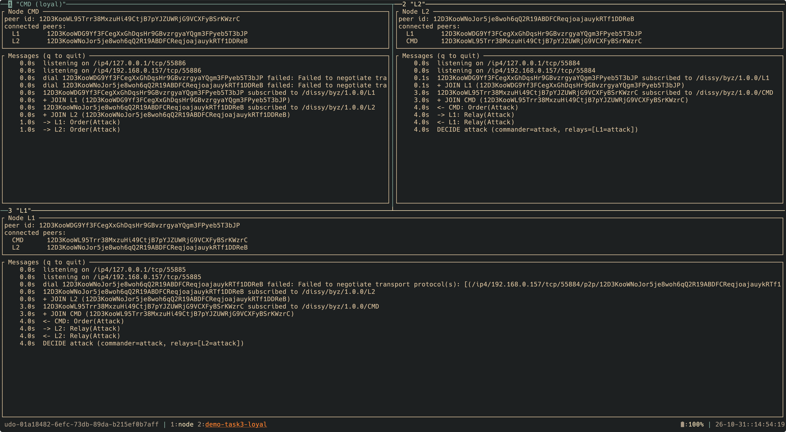

- Traitor commander:

  The commander sends `Attack` to L1 and `Retreat` to L2. Both lieutenants relay
  honestly, so each holds one `attack` and one `retreat`. Both break the tie with
  the commander's order: L1 decides `attack`, L2 decides `retreat`. The loyal
  lieutenants disagree, so agreement is violated.

**Task 3 - Commander Traitor**
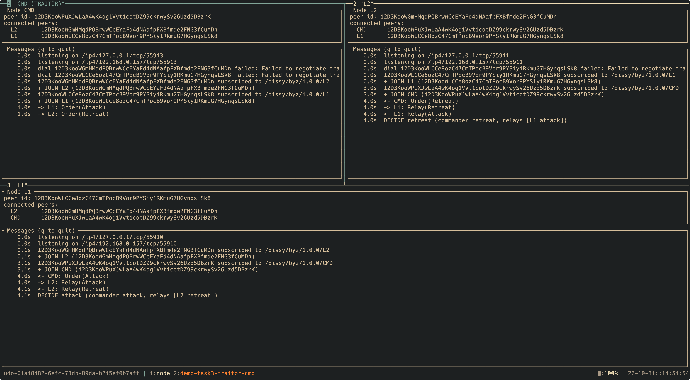

- Traitor lieutenant (additional run):

  The loyal commander sends `Attack` to both; the traitor L2 relays `Retreat`
  to L1. L1 breaks the tie with the commander's order and decides `attack`, so
  validity holds for the only loyal lieutenant.

**Task 3 - Lieutenant Traitor**
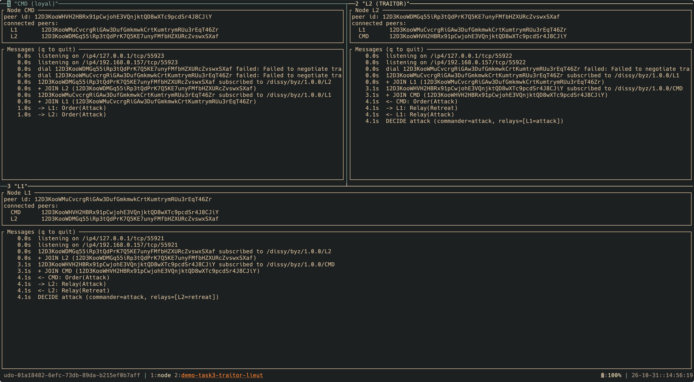

| Run               | Commander         | L1 decides | L2 decides            | Agreement |
| :---------------- | :---------------- | :--------- | :-------------------- | :-------- |
| All loyal         | `attack` to both  | `attack`   | `attack`              | yes       |
| Traitor commander | L1 `attack`, L2 `retreat` | `attack` | `retreat`         | **no**    |
| Traitor L2        | `attack` to both  | `attack`   | (traitor, irrelevant) | yes       |

**Why can a lieutenant not tell the two situations apart?**

Compare L1's log in the last two runs: in both it receives `Order(Attack)` from
the commander and `Relay(Retreat)` from L2, and in both it logs exactly
`DECIDE attack (commander=attack, relays=[L2=retreat])`. In the first case the
commander lied, in the second L2 lied, but L1's view is identical. Since L1 sees
the same input, any deterministic rule must produce the same decision in both
cases. To guarantee validity when the commander is loyal (traitor lieutenant
run), L1 must follow the commander's order. By symmetry L2 does the same, so if
the commander is the traitor, the two loyal lieutenants follow two different
orders and disagree. Any other rule breaks validity instead. With only two
lieutenants there is no third value that could act as a majority, so agreement
and validity cannot both be guaranteed with three nodes.

Gossipsub's signatures do not help here: they prove that the relay `Retreat`
was sent by L2, but not that the commander actually told L2 `Retreat`. These are
oral messages; a lieutenant cannot prove what it received.

### Task 3.3

For four nodes no change in the protocol was necessary: the number of
lieutenants is a command-line argument (`--lieutenants 3`), every lieutenant
relays its order to all other ready lieutenants, and `decide()` takes the
majority over the commander's order and the two relays. With three values a
tie can no longer occur, so the commander's order no longer acts as a
tie-breaker.

- All loyal:

**Task 3.3 - Loyal**
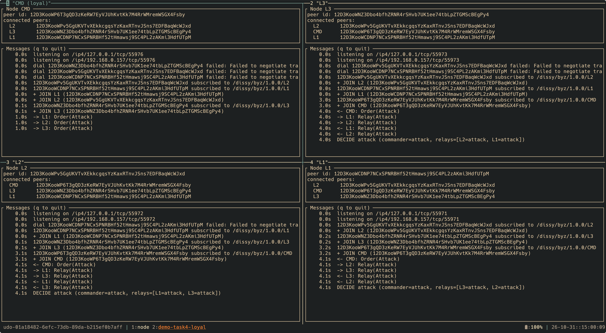

  The commander sends `Attack` to all three lieutenants, all relays are
  `Attack`, and all lieutenants decide `attack`.

- Traitor commander:

**Task 3.3 - Commander Traitor**
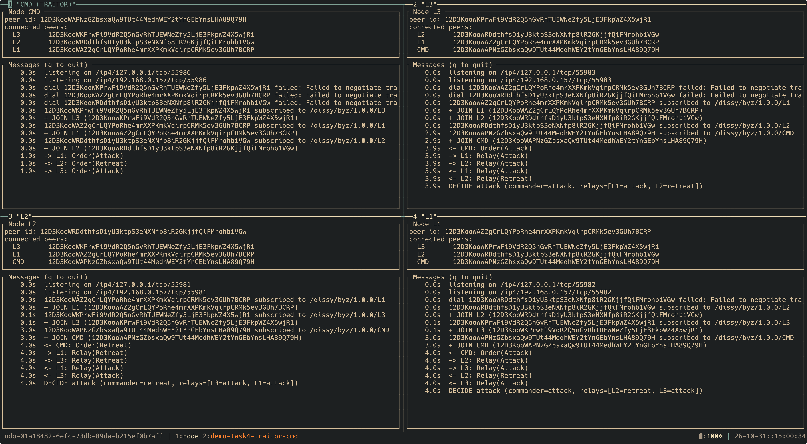

  The commander sends `Attack` to L1 and L3 but `Retreat` to L2. The loyal
  lieutenants relay honestly, so every lieutenant ends up holding the same three
  values: `attack`, `retreat`, `attack`. All decide `attack`. L2 logs
  `DECIDE attack (commander=retreat, relays=[L3=attack, L1=attack])`: it is
  outvoted by the relays and overrules the order it received itself. With
  three nodes this was impossible, because there was only one relay and the tie
  had to be broken by the commander's order.

- Traitor lieutenant (L3):

**Task 3.3 - Lieutenant Traitor**
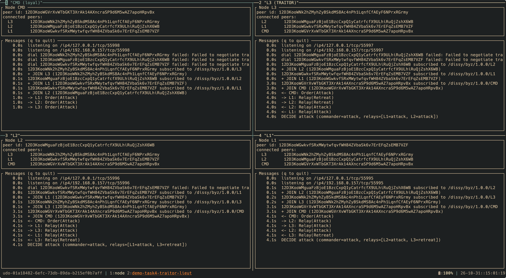

  The loyal commander sends `Attack` to all; the traitor L3 relays `Retreat` to
  L1 and L2. Each loyal lieutenant holds two correct values (commander and the
  other loyal lieutenant) and one false value, so the majority is `attack`.
  Both loyal lieutenants decide `attack`, so agreement and validity hold.

| Run               | Commander sends             | L1       | L2       | L3                    | Agreement |
| :---------------- | :-------------------------- | :------- | :------- | :-------------------- | :-------- |
| All loyal         | `attack` to all             | `attack` | `attack` | `attack`              | yes       |
| Traitor commander | L1, L3 `attack`; L2 `retreat` | `attack` | `attack` | `attack`            | yes       |
| Traitor L3        | `attack` to all             | `attack` | `attack` | (traitor, irrelevant) | yes       |

**Why does this work now?** With at most one traitor, there are two cases:

- If the commander is the traitor, all lieutenants are loyal and relay exactly
  what they received. Every loyal lieutenant therefore votes over the same set
  of values and reaches the same majority, whatever the commander sent.
- If a lieutenant is the traitor, the commander is loyal. Each loyal lieutenant
  receives the correct order from the commander and from the other loyal
  lieutenant, so only one of its three values can be wrong and the majority is
  the commander's order.

In both cases the loyal lieutenants agree, which matches the bound of
`n >= 3m + 1` nodes to tolerate `m` traitors (here `4 >= 3 * 1 + 1`).

### Task 3.4

- Why does majority voting succeed with three lieutenants but fail with only
  two?

  With two lieutenants, each one holds only two values: the commander's order
  and one relay. If they differ, there is no majority and the lieutenant cannot
  know which of the two sources lied (see Task 3.2). With three lieutenants,
  each one holds three values. A single traitor can falsify at most one of them,
  so the two correct values always form the majority. If the commander is the
  traitor, all lieutenants relay honestly and therefore vote over the same set of
  values. In general, `m` traitors require at least `3m + 1` nodes.

- What does the commander provide that makes agreement possible with four nodes,
  and why does the problem become harder when all nodes are equal?

  The commander provides a single source for the value: all lieutenants agree on
  what the commander said, not on a value of their own. Everyone knows who the
  commander is and that its order is the proposal. Without a coordinator, every
  node has its own input value, so the nodes would have to run one agreement per
  node (every node acting as a commander once) or first elect a leader. Electing
  a leader is itself an agreement problem, and a traitor can take part in the
  election. Note that in our implementation the role is only claimed in the name
  exchange, so a traitor could also claim to be the commander.

- Your four-node implementation guarantees agreement, but can it identify which
  node is the traitor? Explain what a loyal node can and cannot observe.

  No, not in general. A loyal node can observe the values it received and,
  thanks to gossipsub signatures, who sent each of them. It cannot observe what
  the commander sent to the other lieutenants. If a relay disagrees with the
  order the node received itself, either the relaying lieutenant lied or the
  commander sent that lieutenant a different order; both look identical. In the
  traitor commander run, L1 sees `L2=retreat` and cannot tell whether L2 or the
  commander lied. Only L2 could conclude that the commander lied (both other
  lieutenants contradict its order, and there is at most one traitor). Agreement
  does not require identifying the traitor; the majority simply outvotes it.

- How could nodes communicate when multicast is blocked? Does the middleware
  offer such a feature?

  Without multicast, nodes need at least one known entry point. The simplest
  option is static bootstrap addresses: a node is started with the multiaddr of
  a known peer and dials it directly (`swarm.dial(addr)`). `libp2p` offers more
  than that:
  - **Kademlia DHT** (`libp2p-kad`): after connecting to a few bootstrap nodes,
    peers find each other through the distributed hash table.
  - **Rendezvous** (`libp2p-rendezvous`): peers register under a namespace at a
    rendezvous server and query it for other peers.
  - **Circuit Relay v2, DCUtR and AutoNAT**: for peers behind NATs, which relay
    traffic through a public node and try to upgrade to a direct connection
    using hole punching.

  Our implementation only uses mDNS, but any of these could be added as another
  behaviour to `NetwBehaviour` without changing the application logic.
