# EX05 Report: [Fault Tolerance & Coordination]

**Student Name:** [leave this exactly like this]  
**Student ID:** `leave this exactly like this`  
**Group Name:** `MAP`

---

## Task 1 - [Distributed Auction]

### Infrastructure

To setup our five nodes and the zookeeper server we decided to use 6 multipass
ubuntu virtual machines. This decision was made because they can easily be setup
via a shell script once multipass is installed locally.
(on macos `brew install --cask multipass`, but consult your installed package
manager documentation). Also the cargo package `zig-build` is needed, as well as
`zig` for cross compilation. Make sure these are installed via your chosen
package manager/cargo.

To cross compile the rust binary for 

Taking a look at `multipass_up.sh`:

```bash
launch() {
  multipass info "$1" >/dev/null 2>&1 || multipass launch 24.04 --name "$1" --memory "$2"
}
```

This is our launch function. We pass two arguments, one is used as the name of
the VM and the other as the amount of RAM we want to allocate. Only one side of
the logical OR `||` is executed. The first part succeeds if a VM with the given
name exists already, stdout and stderr are redirected to `/dev/null`.
If a VM with the given name doesn't exist already, we spin it up via 
`multipass launch`.

```bash
launch zk 1G &
for i in 1 2 3 4 5; do
  launch node$i 512M &
done
for job in $(jobs -p); do wait "$job"; done
```

In this code snippet we first start up our dedicated zookeeper server, then our
five node VMs and we wait for all of them to finish. `&` makes it happen in the
background in parallel.

```bash
until multipass exec zk -- true 2>/dev/null; do sleep 2; done
multipass exec zk -- sudo apt-get update
multipass exec zk -- sudo apt-get install -y zookeeperd
```

In the first line we wait for the zk VM to be up and running and then install
Apache Zookeeper on it.

We need the zk VMs IPv4 address for the five nodes to connect to it, which we
could look up with multipass list, but we added the following snippet as a
quality of life feature, the needed IPv4 address is written to /etc/hosts in
each of the five nodes.

```bash
ZK_IP=$(multipass info zk --format csv | awk -F, 'NR==2 {print $5}')
for i in 1 2 3 4 5; do
  multipass exec node$i -- sudo sh -c "sed -i '/ zk\$/d' /etc/hosts && echo '$ZK_IP zk' >> /etc/hosts"
done
```

With this done we have our infrastructure up and running and it is time for the
actual auction program.

As stated in the task description we will implement it as follows:

- single auction with a single item
- standalone zookeeper server, no ensemble
- command-line interface, no GUI or webserver
- Nodes communicate exclusively through ZooKeeper
- Even though everything is running locally, the nodes run in separate VMs and
  communicate over the network, no reliance on shared memory or local files

### Deployment

We have a short bash script that compiles our Rust code for linux and uses
multipass transfer to put the binary into each nodes home directory, and then
make it executable, also it checks the host machines architecture using uname to compile correctly:

```bash
#!/usr/bin/env bash
set -e
cd "$(dirname "$0")/../auction"

# Build for the VMs' architecture (multipass VMs match the host CPU:
# aarch64 on Apple Silicon, x86_64 on Intel/AMD). Ask a VM directly.
arch=$(multipass exec node1 -- uname -m </dev/null)

case "$arch" in
  aarch64|arm64) TARGET=aarch64-unknown-linux-musl ;;
  x86_64|amd64)  TARGET=x86_64-unknown-linux-musl ;;
  *) echo "unsupported VM architecture: $arch" >&2; exit 1 ;;
esac

echo "building for $TARGET"
rustup target add "$TARGET" >/dev/null 2>&1 || true
cargo zigbuild --release --target "$TARGET"
BIN=target/$TARGET/release/auction

for i in 1 2 3 4 5; do
  multipass transfer "$BIN" node$i:/home/ubuntu/auction
  multipass exec node$i -- chmod +x /home/ubuntu/auction
done


```

### Zookeeper

Our Zookeeper server uses different znodes, addressed by absolute paths.
- `/auction`: is a persistent znode. It holds the global auction state
- `/auction/nodes`: is an empty persistent znode. It simply acts as a folder, a
  parent to the following:
- `/auction/nodes/<id>`: are ephemeral nodes. They exist per node, as long as a
  session to the zookeeper server with that node exists.

> `persistent` znodes survive client crashes and Zookeeper restarts. It logs
  transactions.
  
> `ephemeral` znodes are bound to a session and deleted when the session ends,
  ephemeral nodes can't have any children.

**Why is this useful?** Reads/Writes to a znode are atomic. We will explain more
when we look at the code.

Useful commands inside the zk server:
* `./zkCli.sh -server localhost:2181 deleteall /auction >/dev/null 2>&1` (delete
  the auction state completely)
* `./zkCli.sh -server localhost:2181` (connect to the zookeeper server REPL)

or inside zkCli interactive shell:
* `get /auction` (get the auction state)
* `stat /auction` (get the stats (e.g. version number, ...) of the auction node)
* `ls /auction/nodes` (list all auction(s) (nodes))

### Implementation

When starting up the auction binary on each node, we provide the zk-servers IPv4
address, a name and an optional command as command-line arguments:

```rust
#[derive(Parser)]
struct Args {
    #[arg(long)]
    zk: String, // "<zk-ip>:2181"
    #[arg(long)]
    id: String, // e.g. "node1"
    #[command(subcommand)]
    cmd: Option<Cmd>, // none → interactive REPL
}
```

The first two things happening in our main function are `let c =
connect(&args.zk).await?;` and `init(&c, &args.id).await?;` so lets take a look
at those functions.

```rust
async fn connect(addr: &str) -> Result<zk::Client> {
    let client = zk::Client::connector()
        .with_session_timeout(Duration::from_secs(5))
        .connect(addr)
        .await?;
    Ok(client)
}
```

Here we take the provided IPv4 address of our zk-server and use the Zookeeper
Rust Api to establish a tcp connection. The client sends a heartbeat,
`with_session_timeout(5s)` lets the session expire if zk doesn't get one for 5
seconds and will delete the according ephemeral nodes but more on that later.

To understand the init function we take a quick look at how our auction state is
saved first:

```rust
#[derive(Serialize, Deserialize, Debug, Clone, Default)]
struct AuctionState {
    closed: bool,
    highest: u64,
    bidder: Option<String>,
    winner: Option<String>,
}
```

It is a simple struct consisting of the information whether it is closed or not,
the highest bid, the according bidder and winner only if they exist. Deriving
`Serialize` and `Deserialize` lets us parse it into JSON and back easily.
Deriving `Default` lets us create a struct of type AuctionState holding the
values `{false, 0, None, None}`.

this is how `initial` is created:

```rust
async fn init(c: &zk::Client, id: &str) -> Result<()> {
    let initial = serde_json::to_vec(&AuctionState::default())?;
    create_ignore_exists(c, AUCTION, &initial, zk::CreateMode::Persistent).await?;
    create_ignore_exists(c, NODES, b"", zk::CreateMode::Persistent).await?;
    c.create(
        &format!("{NODES}/{id}"),
        b"",
        &zk::CreateMode::Ephemeral.with_acls(zk::Acls::anyone_all()),
    )
    .await?;
    Ok(())
}
```

`create_ignore_exists` is where the persistent `/auction` zk node is created, if
it doesn't already exist. Since all 5 nodes run the same binary, all of them
will try to create it, but only the first one to do so will actually succeed. We
pass the client, the path `AUCTION` (path: `"/auction"`), the default auction state as a
json byte vector, since the zookeeper nodes simply store bytes, and the
CreateMode, which we want to be persistent for this node. Also the empty
"directory" node `NODES` is created (path: `"/auction/nodes"`), here we simply
pass `b""` as data since it just acts as parent for the ephemeral nodes.

Inside the `create_ignore_exists` function:

```rust
async fn create_ignore_exists(
    c: &zk::Client,
    path: &str,
    data: &[u8],
    mode: zk::CreateMode,
) -> Result<()> {
    match c
        .create(path, data, &mode.with_acls(zk::Acls::anyone_all()))
        .await
    {
        Ok(_) | Err(zk::Error::NodeExists) => Ok(()),
        Err(e) => Err(e.into()),
    }
}
```

We simply call the zookeeper function `create` with the given parameters.
`.with_acls(zk::Acls::anyone_all())` sets access rights for the created nodes
(ACL = Access Control List). Everyone may read and write.

We then match the return value of this create call against two cases:
* `OK(_)` on success or `Err(zk::Error::NodeExists)` the node already exists =>
  we return `OK(())`
* other `Err(e)` => we return the error

Last thing happening in the init function, each node creates its own ephemeral
znode, here we don't use create inside the create_ignore_exists, because if this
node already exists we want the program to throw an error, since another node
with the same id is already registered.

```rust
c.create(
        &format!("{NODES}/{id}"),
        b"",
        &zk::CreateMode::Ephemeral.with_acls(zk::Acls::anyone_all()),
    )
    .await?;
```

### Bid, Query, Close and the corresponding Zookeeper mechanisms

We implemented a REPL where commands can be executed, we wont go indepth into
how it works since its not that important to the exercise, but rather what
happens when each command is executed. As the task states, commands include `bid
<participants_name> <amount>`, `query` and `close`

- Command `bid` corresponds to the function of the same name:

```rust
async fn read_state(c: &zk::Client) -> Result<(AuctionState, i32)> {
    let (data, stat) = c.get_data(AUCTION).await?;
    Ok((serde_json::from_slice(&data)?, stat.version))
}

async fn bid(c: &zk::Client, who: &str, amount: u64) -> Result<AuctionState> {
    loop {
        let (mut s, version) = read_state(c).await?;
        if s.closed {
            bail!("rejected: auction closed");
        }
        if amount <= s.highest {
            bail!("rejected: {amount} <= current highest {}", s.highest);
        }
        s.highest = amount;
        s.bidder = Some(who.to_string());
        match c
            .set_data(AUCTION, &serde_json::to_vec(&s)?, Some(version))
            .await
        {
            Ok(_) => return Ok(s),
            Err(zk::Error::BadVersion) => continue,
            Err(e) => return Err(e.into()),
        }
    }
}
```

`read_state` uses the zookeeper function `get_data` which returns the raw json
bytes of the auction state and the meta data of the znode. We parse the json
back into our struct and get the version of the znode, we return both as a
tuple. The version is counted up every time a write action happens on that node,
we need to pass the version in the zookeeper call `set_data` to ensure that no
write has happened by another node in between of us reading the data and us
writing the data. The zookeeper server checks the passed version against its
current version and updates the state if they match, all in one atomic write,
which is important. If it is the case, that the version is outdated we enter the
match branch of `Err(zk::Error::BadVersion)`, and just try again, hence the loop
{} around everything. Also trivially we check if the bid is higher than the
current highest bid. 

* Command `query` simply uses the read_state function and prints the
  AuctionState struct, that is parsed into by the raw bytes that are received
  from the zookeeper call `get_data`
* Command `close` corresponds to this function:

```rust
async fn close(c: &zk::Client) -> Result<AuctionState> {
    loop {
        let (mut s, version) = read_state(c).await?;
        if s.closed {
            return Ok(s);
        }
        s.closed = true;
        s.winner = s.bidder.clone();
        match c
            .set_data(AUCTION, &serde_json::to_vec(&s)?, Some(version))
            .await
        {
            Ok(_) => return Ok(s),
            Err(zk::Error::BadVersion) => continue,
            Err(e) => return Err(e.into()),
        }
    }
}
```

Again we use read_state, and simply try to use set_data to set closed = true,
again this only works if the version remained the same and no writes have
happened in between us reading the data and us trying to rewrite the data. If
the version is "bad", we simply read the new data and try again. It is also here
where we set the winner to the current highest bidder.

Finally we also spawn a watcher that keeps all nodes updated if the state of
`"/auction"` changes and a state log to see when nodes connect/disconnect.

```rust
fn spawn_watch(c: zk::Client) {
    tokio::spawn(async move {
        loop {
            let Ok((data, stat, watcher)) = c.get_and_watch_data(AUCTION).await else {
                tokio::time::sleep(Duration::from_secs(1)).await;
                continue;
            };
            if let Ok(s) = serde_json::from_slice::<AuctionState>(&data) {
                println!("[watch v{}] {s:?}", stat.version);
            }
            watcher.changed().await;
        }
    });
}

fn spawn_state_log(c: &zk::Client) {
    let mut w = c.state_watcher();
    tokio::spawn(async move {
        loop {
            let st = w.changed().await;
            println!("[session] {st:?}");
            if st.is_terminated() {
                break;
            }
        }
    });
}
```

Uses the Zookeeper function calls `get_and_watch_data` and `.changed()`.
`get_and_watch_data` returns a triple of data and stat, we have already seen
those, and a watcher, which exists until `watcher.changed().await` is finished.
The async task stalls here until the auction state changes. Because everything
is in a Rust loop, a new watcher is created and the changed state + version is
printed every time the state changes.

### Experiment

To start the nodes use `./multipass_up.sh` in the `/infra` dir. This should
start 6 ubuntu vms (5 nodes, 1 Zookeeper Server). To build and deploy the
program use `./deploy.sh`. This uses the already talked about `zig-build` cargo
package and `zig` to cross-compile the program to linux with host machines
architecture. It also transfers the binary to the 5 nodes.

We start five application nodes on different VMs plus our Zookeeper server. I
will show screenshots of what happens when we place some bids and eventually
close the auction.

Order of commands:
- node1: `bid alice 50`
- node3: `bid bob 20`
- node4: `bid hans 340`
- node5: `close`

We can see that whenever a bid was made, it got either rejected or accepted in the terminal of that node, and also each nodes converged to the same final version 3.

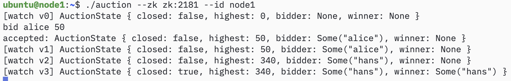
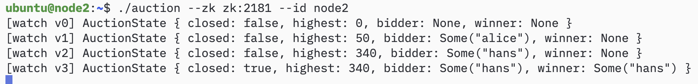
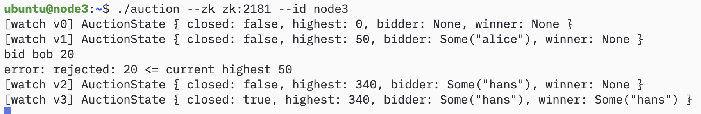
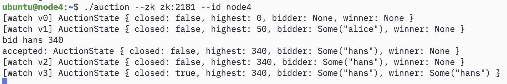
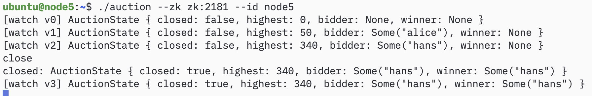

---

And a demonstration of query and bidding when an auction is closed:
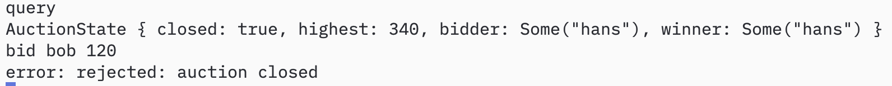


---

## Task 2 - [Concurrent Bids]

Our current implementation of Task 1 actually already fulfills all of the given conditions.

### Concurrent bids cannot overwrite a higher accepted bid with a lower one

In our `bid` function, either the given bid is simply lower than the current
highest bid, which we then reject:

```rust
if amount <= s.highest {
    bail!("rejected: {amount} <= current highest {}", s.highest);
}
```

Or we make a bid higher than the current bid, but before we can write it to the
state, another node is faster and bids even higher, then when trying to call
`c.set_data(AUCTION, &serde_json::to_vec(&s)?, Some(version)).await`, the return
value would be `Err(zk::Error::BadVersion)`. The new state would be fetched and
again amount is checked against s.highest, where now amount will be smaller.

### The auction can only be closed once, with a single final result

Pretty much the same concept here. Either the auction is already closed:

```rust
if s.closed {
    return Ok(s);
}
```

Or something happened in between the node calling the close and actually getting
to call set_data, again it will return a BadVersion Error.

### Bids cannot be accepted after the auction has been closed

Handled in the `bid` function:

```rust
if s.closed {
    bail!("rejected: auction closed");
}
```

### A bid submitted concurrently with auction closure is either committed before closure or rejected

This is again handled through the concept of Zookeeper state versions that we
already talked about. Bid and close both write against version v. If the bid's
write lands first, close retries and includes the bid. If close lands first, the
bid's write fails, its retry sees closed, and the bid is rejected. There is no
third outcome.

### Experiment

We use a small bash script in order to:

* Submit two competing bids simultaneously through different nodes
* Attempt to submit a bid while another node closes the auction

`task2.sh`:
```bash
#!/usr/bin/env bash
ZKCLI=/usr/share/zookeeper/bin/zkCli.sh

run() {
  local node=$1 id=$2; shift 2
  multipass exec "$node" -- /home/ubuntu/auction --zk zk:2181 --id "$id" "$@" </dev/null
}

reset() {
  multipass exec zk -- sh -c "$ZKCLI -server localhost:2181 deleteall /auction >/dev/null 2>&1" </dev/null
  run node3 seed bid seed 100
}

echo "== 1) two competing bids"
reset
run node1 a bid alice 150 &
run node2 b bid bob 140 &
wait
run node3 q query

echo "== 2) bid while another node closes"
reset
run node1 a bid alice 200 &
run node2 c close &
wait
run node3 q query
```

The script is executed on the host machine, not inside one of the VMs. It
controls all VMs via `multipass exec`, which runs a command inside the given VM.

Instead of the interactive REPL, the auction binary is started in its one-shot
mode here: the command is passed directly as a command-line argument (e.g. `bid
alice 150`), the binary connects to Zookeeper, executes exactly this one
command, prints the result and exits.

```bash
run() {
  local node=$1 id=$2; shift 2
  multipass exec "$node" -- /home/ubuntu/auction --zk zk:2181 --id "$id" "$@" </dev/null
}
```

`run` takes the VM name, an id and the actual auction command. The first two
arguments are saved in `node` and `id`, `shift 2` removes them from the argument
list, so `"$@"` only contains the auction command, e.g. `bid alice 150`. This
way the same function works for `bid`, `close` and `query`. Every process gets
its own id, because each one registers its own ephemeral znode
`/auction/nodes/<id>`, two live sessions with the same id would fail with
`NodeExists`. `</dev/null` makes sure `multipass exec` doesn't get our terminal
as input, otherwise the commands we start in the background could get suspended
when they try to read from it.

```bash
reset() {
  multipass exec zk -- sh -c "$ZKCLI -server localhost:2181 deleteall /auction >/dev/null 2>&1" </dev/null
  run node3 seed bid seed 100
}
```

`reset` creates a fresh auction before each experiment. We use `zkCli.sh`, the
command-line client that comes with Zookeeper, inside the zk VM. `deleteall
/auction` deletes `/auction` and everything below it (`/auction/nodes` and all
ephemeral nodes). Zookeeper itself can only delete znodes without children,
`deleteall` walks the tree on the client side and deletes it bottom-up. Its
output is discarded, on the very first run `/auction` doesn't exist yet, which
is harmless. The redirect to `/dev/null` happens inside the VM on purpose,
redirecting the output of `multipass exec` itself to `/dev/null` made it hang.

Afterwards node3 places a first bid of 100 as participant `seed`. Since
`/auction` was just deleted, the `init` function creates it again with the
default state (version 0) and the bid sets it to version 1. Both experiments
therefore start from the same known state: highest bid 100 by `seed`.

```bash
run node1 a bid alice 150 &
run node2 b bid bob 140 &
wait
run node3 q query
```

The two competing operations are started at the same time on two different VMs.
`&` runs a command in the background, so the script doesn't wait for the first
one to finish before starting the second one. `wait` then waits until both
background commands are done. Finally node3 queries the resulting state.

### Output

```
== 1) two competing bids
accepted: AuctionState { closed: false, highest: 100, bidder: Some("seed"), winner: None }
accepted: AuctionState { closed: false, highest: 140, bidder: Some("bob"), winner: None }
accepted: AuctionState { closed: false, highest: 150, bidder: Some("alice"), winner: None }
AuctionState { closed: false, highest: 150, bidder: Some("alice"), winner: None }
== 2) bid while another node closes
accepted: AuctionState { closed: false, highest: 100, bidder: Some("seed"), winner: None }
closed: AuctionState { closed: true, highest: 100, bidder: Some("seed"), winner: Some("seed") }
Error: rejected: auction closed
AuctionState { closed: true, highest: 100, bidder: Some("seed"), winner: Some("seed") }
```

The first line of each experiment is the seed bid from `reset`, the last line is
the final `query` from node3.

**1) Two competing bids**

Both bids are higher than the seed bid, so both pass the first check. In this
run bob's 140 was written first (version 1 → 2). Alice's bid then either read
the new state directly, or read version 1, got `BadVersion` on `set_data` and
read again. Either way it was validated against the current state with highest
140, 150 > 140, so it was accepted (version 3).

In another run the order was the other way around: alice's 150 landed first and
bob's 140 was rejected with `rejected: 140 <= current highest 150`.

Both orders lead to the same final state, highest bid 150 by alice. A lower bid
never overwrote a higher one, it was either accepted before the higher one
arrived or rejected afterwards.

**2) Bid while another node closes**

Here the close was written first (version 1 → 2), with winner `seed`. Alice's
bid then read a state with `closed: true` and was rejected with `rejected:
auction closed`. The final state is closed with a single result.

The other possible outcome would be alice's bid landing first: the close would
then get `BadVersion`, read again, see the bid of 200 and close the auction with
winner alice. In both cases the bid is either committed before the closure or
rejected, there is no third outcome, e.g. a closed auction with alice's 200 as
highest bid but `seed` as winner.

### Observations

* The order of the two operations differs between runs, since it depends on
  which `multipass exec` call reaches Zookeeper first. The final state was
  always one of the expected outcomes.
* Both commands are started with `&` but `multipass exec` takes a few hundred
  milliseconds to start, so they don't start at exactly the same moment. A real
  write conflict, where both read the same version, can therefore happen but
  doesn't happen in every run. Our program doesn't print it when `set_data`
  fails with `BadVersion` and is retried, so we can only check the final
  results, not how often a retry was actually needed. Even without an actual
  conflict, the guarantees hold, because every write is checked against the
  current version by the Zookeeper server.
* No locks are used anywhere. Each node is a separate process on a separate VM,
  so a lock inside one process wouldn't stop the other nodes anyway. The
  Zookeeper server, which checks the version and writes the data in one atomic
  step and applies all writes one after another, is the single point where
  concurrent operations are ordered.

In the VMs we additionally ran the interactive REPL on each node, which prints
every state change it is notified about by its watch:

```
ubuntu@node2:~$ ./auction --zk zk:2181 --id node2
[watch v2] AuctionState { closed: true, highest: 100, bidder: Some("seed"), winner: Some("seed") }
[watch v2] AuctionState { closed: false, highest: 150, bidder: Some("alice"), winner: None }
[watch v1] AuctionState { closed: false, highest: 100, bidder: Some("seed"), winner: None }
[watch v2] AuctionState { closed: true, highest: 100, bidder: Some("seed"), winner: Some("seed") }
```

The first line is the state left over from the previous run, read when the node
starts. Then `task2.sh` was executed: `reset` deletes `/auction`, which triggers
the watch, but reading the deleted znode fails, so our watch loop waits a second
and tries again. In that time the new auction is created (v0) and the seed bid
is placed (v1), so the next line it prints is already alice's 150 (v2), bob's
bid was rejected in this run and didn't create a new version. For experiment 2
the same happens again, this time the node catches the new auction at v1, and
then the close at v2.

Two things can be seen here:
* The version starts at 0 again after `/auction` is deleted and created again.
  `v2` in line 2 and `v2` in line 4 are two different auctions. Zookeeper tells
  them apart by `czxid`, the id of the transaction that created the znode.
* A watch only notifies that something has changed, after which we read the
  current state. Changes that happen in between are skipped, which is why v0 and
  v1 are often missing. The output of `task2.sh` is therefore what we use to
  check which bids were accepted or rejected, the REPL output only shows that
  all nodes end up seeing the same state.

## Task 3 - [Crash Recovery and Stale State]

### Experiment

In the two screenshots below we can see what the final outputs of node A and B
look like when we do the following:

* start both nodes and submit through node A
* terminate node A (ctrl + c)
* submit higher bid through node B and close auction
* restart node A

Node A:
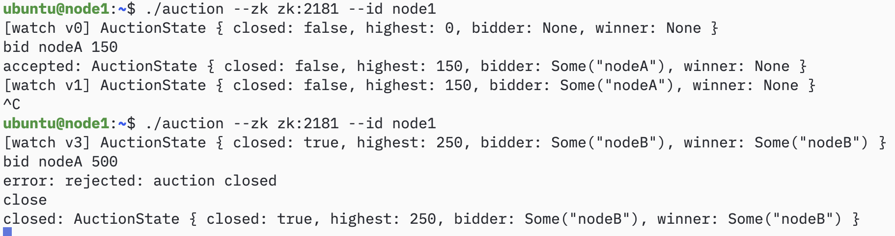
Node B:
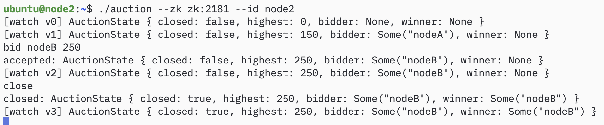

We can see that after restarting node A it watches the correct state v3, where
the current highest bidder is node B with 250. Also when trying to bid higher
than node B it gets rejected since the auction is closed already.

As a randomly injected fault I also tried shutting down one of the vms running
the auction program entirely (`multipass stop`). Then reconnecting on a different
vm with the same id and the auction system will still be in a correct state and
functional.

Node1: makes a bid, sees Node2's bid and then the vm shuts down
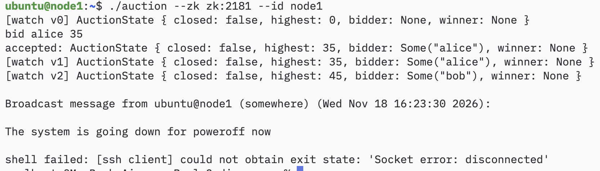

Node2:
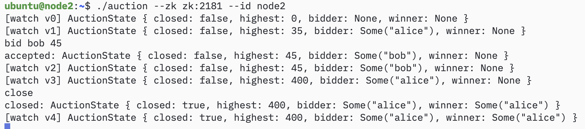

Node3: reconnects with Node1's ID, and can still take action
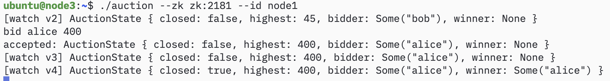


### Network Disconnect Experiment

We connect with node 2 and node 3, node 2 makes a bid.
We now simulate a network disconnect by running `multipass exec node2 -- sudo iptables -A OUTPUT -p tcp --dport 2181 -j DROP`
This prevents tcp packets from node 2 to be sent to the zookeeper server.
During the disconnect node 3 makes a higher bid.
Also during disconnect any commands coming from node 2 are rejected.
`multipass exec node2 -- sudo iptables -D OUTPUT -p tcp --dport 2181 -j DROP` disables this rule again, we reconnect on node 2 and see what happens. 
Node 2 has the correct state after reconnecting.

Node 2:
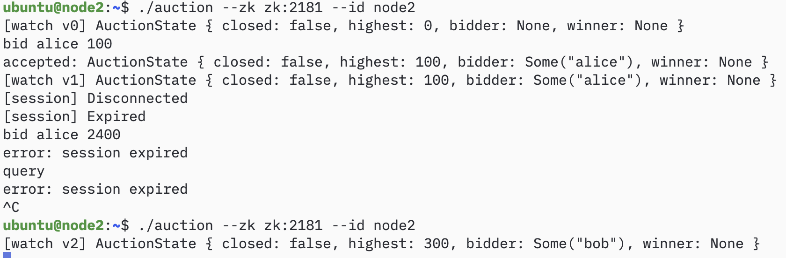

Node 3:
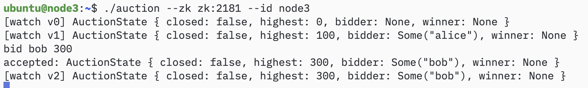

## Questions

> How is the auction state represented in ZooKeeper? Which parts must be persistent?

The whole auction state (`closed`, `highest`, `bidder`, `winner`) is stored as
JSON in the single persistent znode `/auction`. Below it, the persistent and
empty `/auction/nodes` acts as a parent for one ephemeral znode
`/auction/nodes/<id>` per running node. Everything that defines the outcome of
the auction must be persistent, so it survives crashes of any node, which is why
it lives in `/auction`. The ephemeral znodes only show which nodes are currently
connected, losing them is intended. The nodes themselves keep no state locally.

> Which ZooKeeper mechanisms prevent conflicting updates from concurrent nodes?

Versioned writes: every znode has a `version` that is increased by each write,
and `set_data(path, data, Some(version))` is only applied if the version is
still the one we read, otherwise it fails with `BadVersion`. The ZooKeeper
server checks the version and writes the data in one atomic step and applies all
writes one after another in a single order. Together with our read, check, write
and retry loop, a write can only succeed if it was checked against the current
state. Additionally `create` fails atomically with `NodeExists`, so the initial
state can only be created once.

> What happens if two nodes try to close the auction simultaneously?

Both read the same version with `closed: false` and both try to write `closed:
true` with that version. ZooKeeper applies only the first write, the second one
gets `BadVersion`, reads the state again, sees `closed: true` and returns the
already stored result without writing anything. Both nodes therefore report the
same winner, there is only one final result.

> How does a restarted node obtain the correct auction state?

The node has no local state that could be outdated. On restart it opens a new
session, `init` doesn't overwrite the existing `/auction` (`NodeExists` is
ignored) and every command reads the current state from ZooKeeper with
`get_data`. So a restarted node immediately sees the latest state, e.g. that the
auction is already closed. Even if it acted on an old version, its write would
fail with `BadVersion`.

> What happens if an application node cannot reach ZooKeeper? Why might
  rejecting operations be preferable to continuing with locally cached state?

Its session becomes `Disconnected` and every operation fails with
`ConnectionLoss`. If it stays disconnected longer than the session timeout (5
seconds), ZooKeeper expires the session, deletes its ephemeral znode and the
node gets `SessionExpired` from then on. Bids and closes from this node are
therefore rejected. This is preferable because a locally cached state can be
outdated: other nodes may have accepted higher bids or closed the auction in the
meantime. Acting on the cached state could accept a bid after the auction was
closed or declare a different winner, so there would be two conflicting results.
We choose consistency over availability: a node being temporarily unavailable
can be fixed, a wrong winner can't be undone.
